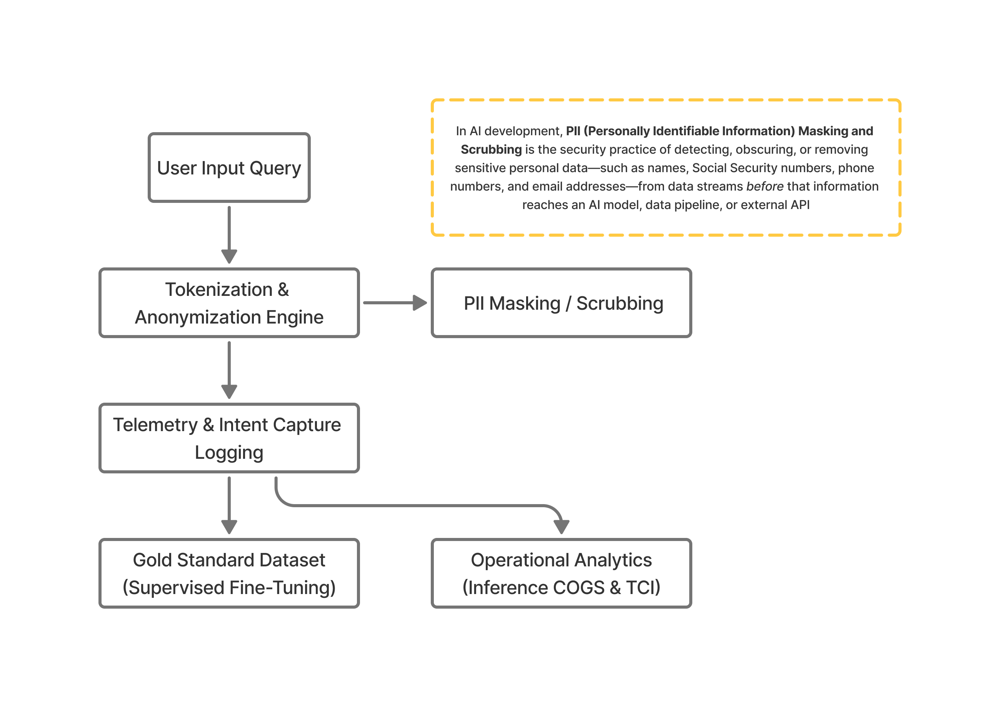

# Product Requirements Document (PRD)

**Project Title:** Project Adaptive Depth: Dynamic Contextual Depth (DCD) Architecture  
**Document Owner:** Lead AI Product Manager / Product Consultant  
**Target Release:** Q1 2027  
**Document Version:** 1.0 (Final)  
**Status:** Research and Analysis 

---

## 1. Product Context & Strategic Objectives

### 1.1 Executive Summary
Current enterprise conversational AI systems (e.g., ChatGPT, Claude, custom internal RAG tools) rely on a linear streaming paradigm. Because large language models (LLMs) are next-token predictors, their default system behavior is exhaustive verbosity. This forces users into reading 500+ word "walls of text" to extract simple, single-sentence answers or concise code blocks.

**Project Adaptive Depth** replaces the flat text output stream with **Dynamic Contextual Depth (DCD)**. DCD decouples prompt ingestion from generation by placing an ultra-fast **Small Language Model (SLM) Intent Router** at ingress. The router evaluates user prompt complexity in under $50\text{ ms}$, calculates a **Task Complexity Index (TCI)** score, and constrains the heavy downstream LLM to output structured **Generative UI (GenUI)** schemas with explicit token budgets.

### 1.2 Core Value Proposition
* **For Users:** Eliminates cognitive fatigue by delivering immediate **Executive Anchors** (1–2 sentence direct answers) backed by interactive, expandable accordions for secondary context.
* **For Business & Engineering:** Reduces inference API expenditures by **15–22%** per session by restricting low-complexity factual responses from generating unnecessary output tokens.

---

## 2. Target Personas & Primary Use Cases

### Persona 1: Executive / Knowledge Worker (The Scavenger)
* **Needs:** Immediate factual lookup, high-level summaries, concise metric extraction.
* **Pain Point:** Spends 30–60 seconds skimming fluff, disclaimers, and preambles to find a simple metric or definition.
* **DCD Experience:** Prompt receives TCI 1–2; system outputs a bold Executive Anchor with zero preamble.

### Persona 2: Software Engineer / Technical Analyst (The Builder)
* **Needs:** Clean executable code snippets, API syntax examples, structural explanations.
* **Pain Point:** Code blocks are buried inside long conversational explanations.
* **DCD Experience:** Code snippet renders prominently at the top; architectural trade-offs and explanations are collapsed into expandable drawer modules.

### Persona 3: Strategy / Equity Analyst (The Deep Thinker)
* **Needs:** Multi-step reasoning, trade-off analysis, multi-hop contextual synthesis.
* **Pain Point:** Overly concise system prompts truncate analytical depth or cause shallow reasoning.
* **DCD Experience:** Prompt receives TCI 4–5; router allocates maximum token budget and unconstrained schema for multi-hop reasoning.

---

## 3. Product Architecture & System Interactions




---------------------------------------

## 4. Detailed Feature Specifications

### Feature 1: SLM Intent Routing Engine
* **Description:** Intercepts every incoming text prompt and runs a multi-class intent classification and complexity estimation pass.
* **Input:** Raw user prompt string.
* **Output Parameters:**
  * `tci_score`: Integer (1 to 5)
  * `generation_mode`: Enum (`RESTRICTED_SCHEMA`, `FREE_FLOW_MARKDOWN`)
  * `max_tokens_override`: Integer (100 to 4096)
  * `ui_schema_target`: Enum (`EXEC_ANCHOR`, `CODE_FOCUS`, `FULL_ANALYSIS`)

### Feature 2: JSON Schema Enforcement & Constraint Injection
* **Description:** Injects schema syntax requirements directly into the heavy LLM's system instructions when TCI $\le 2$.
* **Schema Definition (JSON Schema):**
```json
{
  "$schema": "[http://json-schema.org/draft-07/schema#](http://json-schema.org/draft-07/schema#)",
  "type": "object",
  "properties": {
    "executive_anchor": {
      "type": "string",
      "maxLength": 200,
      "description": "Direct, 1-2 sentence core answer without introductory fluff."
    },
    "key_takeaways": {
      "type": "array",
      "items": { "type": "string" },
      "maxItems": 3
    },
    "deep_dive_sections": {
      "type": "array",
      "items": {
        "type": "object",
        "properties": {
          "section_title": { "type": "string" },
          "content_markdown": { "type": "string" }
        },
        "required": ["section_title", "content_markdown"]
      }
    }
  },
  "required": ["executive_anchor", "deep_dive_sections"]
}


### Feature 3: Progressive Disclosure Front-End (GenUI)

Executive Anchor Block: Rendered at the top in a distinct callout card with bold styling.

Collapsible Accordions: Deep-dive explanations, background context, and secondary code blocks are wrapped in collapsible UI accordions (<details> / <summary>).

Interactive Depth Control Slider: A bottom UI widget allowing users to dynamically adjust display depth (Brief | Standard | Detailed) without re-querying the LLM backend.


## 5. Non-Functional Requirements (NFRs)

