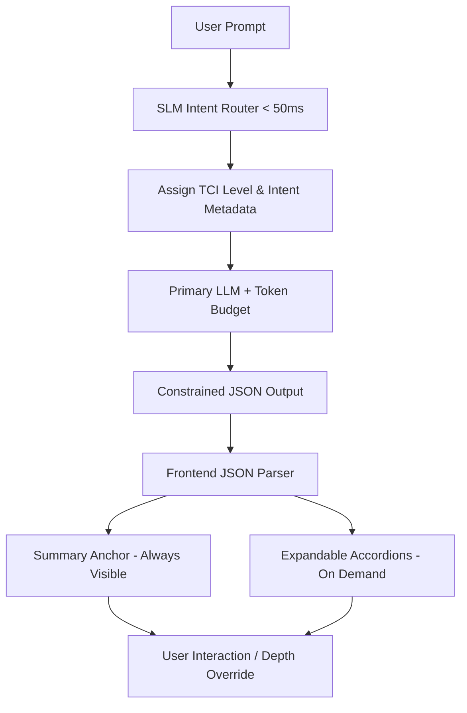

# LLM Response Optimization: Dynamic Contextual Depth (DCD)


> **TL;DR:** A Product Requirements Document (PRD) & AI solution architecture that eliminates LLM "walls of text" by matching response length to user intent—cutting **Read-Time-to-Action (RTTA) by 30%** and **inference API costs (COGS) by 15%**.

---

## Table of Contents
1. [Executive Summary](#1-executive-summary)
2. [Problem Analysis & Project Scope](#2-problem-analysis--project-scope)
3. [Proposed Architecture & Business Rules](#3-proposed-architecture--business-rules)
4. [System Requirements (FR & NFR)](#4-system-requirements-fr--nfr)
5. [Agile User Stories & Acceptance Criteria](#5-agile-user-stories--acceptance-criteria)
6. [UX & AI Trust Framework](#6-ux--ai-trust-framework)
7. [Success Metrics & A/B Evaluation Plan](#7-success-metrics--ab-evaluation-plan)
8. [Kill Criteria & Rollback Governance](#8-kill-criteria--rollback-governance)
9. [Risks, Edge Cases & Dependencies](#9-risks-edge-cases--dependencies)
10. [6-Week Execution Roadmap & Sign-Off](#10-6-week-execution-roadmap--sign-off)

---

> **Document Owner:** Harshal Gopalani, AI Product Manager / Business Analyst | **Date:** September 23, 2026 | **Status:** Proposed / For Executive Review

---

## 1. Executive Summary
**The Business Problem:** 
Standard AI chat interfaces treat every user question the same, defaulting to long, overwhelming "walls of text" regardless of what the user actually needs. For businesses deploying AI at scale, this one-size-fits-all approach creates two major operational issues:

• Poor User Adoption & Slow Decisions: Users struggle to find quick answers inside dense paragraphs, increasing frustration and delaying action (Read-Time-to-Action).

• Inflated Operational Costs: Generating unnecessary text burns through expensive API token budgets without adding real value for the customer.
The Strategic Solution

### The Strategic Solution
**LLM Response Optimization** introduces a **Dynamic Contextual Depth (DCD)** framework. Before generating a response, a lightweight routing layer classifies user intent, enforces a strict token budget, and renders answers using **Generative UI (GenUI)**—delivering a concise two-sentence summary upfront with expandable dropdowns for deeper technical context.
Business Impact
• Lower API Spend: Cuts unnecessary token generation, directly reducing AI operating costs (COGS).
• Better User Experience: Delivers instant, scannable answers for quick queries while keeping deep technical context one click away.


**LLM-response-cost-optimization** introduces a **Dynamic Contextual Depth (DCD)** architecture—pairing an ultra-low-latency **Small Language Model (SLM) Intent Router** with a **Primary LLM** and a **Generative UI (GenUI)** frontend. By classifying prompt complexity pre-generation, enforcing dynamic token budgets, and rendering responses as progressive disclosure components (**Summary Anchors** and expandable **Accordions**), DCD delivers the right information at the right time while cutting inference COGS and preserving deep technical context.

---

### Target Business Outcomes

| Business Dimension | Target Outcome | Strategic Value |
| :--- | :--- | :--- |
| **User Productivity** | **30% reduction** in RTTA | Faster access to actionable answers. |
| **Inference Economics** | **15% reduction** in Compute COGS | Lower monthly API spend per user session. |
| **User Satisfaction** | **80% decrease** in manual corrections | Fewer follow-up prompts (*"make it shorter/longer"*). |
| **System Reliability** | **> 99% JSON schema adherence** | Predictable, crash-free UI rendering. |

---

## 2. Problem Analysis & Project Scope

### 2.1 Root Cause Matrix

| Dimension | Current Bottleneck | Business / User Impact |
| :--- | :--- | :--- |
| **User Experience** | Unconstrained, verbose text generation for simple lookups. | High cognitive load; users waste time scanning filler text. |
| **Unit Economics** | Uncapped output token generation across all query types. | Bloated API compute bills and poor ROI per session. |
| **System Design** | Lack of pre-generation intent classification and UI structure. | Opportunity to introduce **< 50ms** routing and modular UI rendering. |

### 2.2 Scope Boundaries (Non-Goals)
To ensure a focused 6-week MVP rollout, the following are strictly **Out of Scope**:
* **Foundation Model Pre-Training:** Uses off-the-shelf SLMs/LLMs via API rather than training models from scratch.
* **Multimodal Outputs:** Image, audio, and video generation constraints are excluded from Phase 1.
* **Chat History Overhaul:** Existing conversation logging and storage remain unchanged.

---

## 3. Proposed Architecture & Business Rules

### 3.1 Three-Tier Dynamic Contextual Depth (DCD) Pipeline
1. **Tier 1 — Intent Routing (SLM Layer):** Intercepts incoming prompts in **< 50ms**, assigns a **Task Complexity Index (`TCI-1` to `TCI-4`)**, and tags user intent (`Fact`, `Procedural`, `Analytical`).
2. **Tier 2 — Constrained Generation (Primary LLM):** Enforces dynamic token limits and outputs strict, UI-parsable **JSON schemas** instead of raw text streams.
3. **Tier 3 — Generative UI (Frontend Layer):** Renders an immediate **Summary Anchor** alongside collapsible **Accordions** for optional deep dives.



### 3.2 TCI Business Rules Matrix
*Core BA decision logic mapping user prompt complexity to token budgets and UI behavior:*

| TCI Level | Query Type | Target Persona | Max Token Budget | UI Output Behavior |
| :--- | :--- | :--- | :--- | :--- |
| **TCI-1** | Quick Fact / Definition | Any User | `150 tokens` | **Summary Anchor** only |
| **TCI-2** | How-To / Procedural | Novice | `350 tokens` | **Summary Anchor** + 1 Step-by-Step **Accordion** |
| **TCI-3** | Conceptual Comparison | Practitioner | `750 tokens` | **Summary Anchor** + 2 Analytical **Accordions** |
| **TCI-4** | System Design / Code | Expert | `1,500 tokens` | **Summary Anchor** + 3 Deep-Dive **Accordions** |

### 3.3 Data Contract (Sample JSON Output)
```json
{
  "tci_classification": "TCI-2",
  "intent": "Procedural",
  "summary_anchor": "To sync local VS Code files with GitHub, run 'git pull' in your terminal. This fetches and merges remote changes into your active branch.",
  "accordions": [
    {
      "title": "Step-by-Step UI Alternative",
      "content": "1. Open Source Control (Ctrl+Shift+G). 2. Click '...' menu. 3. Select 'Pull'."
    }
  ]
}
```

---

## 4. System Requirements (FR & NFR)

### 4.1 Functional Requirements

| ID | Tier | Requirement | Expected Behavior | Status |
| :--- | :--- | :--- | :--- | :--- |
| **FR-01** | Routing | Pre-generation intent classification | Intercepts prompts and tags intent + expertise level. | `Defined` |
| **FR-02** | Routing | TCI level assignment | Maps queries to `TCI-1` through `TCI-4` prior to generation. | `Defined` |
| **FR-03** | Generation | Constrained JSON decoding | Outputs valid JSON matching strict frontend schemas. | `Defined` |
| **FR-04** | Generation | Dynamic token budgeting | Caps `max_tokens` based on assigned TCI rules. | `Defined` |
| **FR-05** | Interface | Progressive UI rendering | Displays **Summary Anchors** upfront and hides details in **Accordions**. | `Defined` |

### 4.2 Non-Functional Requirements

| ID | Category | Requirement | Acceptance Threshold | Status |
| :--- | :--- | :--- | :--- | :--- |
| **NFR-01** | Latency | Routing overhead remains imperceptible | **< 50ms** routing latency | `Defined` |
| **NFR-02** | Reliability | Consistent structured output parsing | **> 99%** valid JSON responses | `Defined` |
| **NFR-03** | Scalability | Stateless routing microservice | Horizontal scaling via **FastAPI** | `Defined` |
| **NFR-04** | Privacy | PII redaction for router retraining | **100%** PII stripped from telemetry logs | `Defined` |

---

## 5. Agile User Stories & Acceptance Criteria

### 5.1 Story 1 — Business User Fact Retrieval
> *"As a busy business user asking a quick definitional question, I want a concise two-sentence answer without unnecessary preamble, so that I can immediately return to my workflow."*

| Criteria ID | Acceptance Condition | Expected Result |
| :--- | :--- | :--- |
| **AC-01** | Query classification | Classified as **TCI-1**. |
| **AC-02** | Token restriction | Primary LLM capped at **`150 max_tokens`**. |
| **AC-03** | UI rendering | Rendered strictly as a **Summary Anchor** with zero accordions. |

### 5.2 Story 2 — Technical Practitioner Deep Dive
> *"As a software engineer requesting a Python script and architecture breakdown, I want summaries separated from detailed code blocks, so that I can copy code cleanly without losing strategic context."*

| Criteria ID | Acceptance Condition | Expected Result |
| :--- | :--- | :--- |
| **AC-04** | Query classification | Classified as **TCI-4**. |
| **AC-05** | Structured generation | Primary LLM populates predefined multi-accordion **JSON schema**. |
| **AC-06** | UI rendering | Displays **Summary Anchor** followed by collapsible **Technical Accordions**. |

### 5.3 Story 3 — Zero-Prompt Depth Override
> *"As an end-user receiving a brief summary, I want a one-click option to expand depth, so that I do not have to manually type follow-up prompts."*

| Criteria ID | Acceptance Condition | Expected Result |
| :--- | :--- | :--- |
| **AC-07** | Override control | UI displays an interactive **Depth Slider** and **Elicitation Chips**. |
| **AC-08** | On-demand expansion | Clicking a chip triggers background generation and populates new **Accordions**. |

---

## 6. UX & AI Trust Framework

* **Cognitive Load Protection:** **Summary Anchors** deliver the core answer immediately while keeping secondary context collapsed until requested.
* **User Agency:** An explicit **Depth Slider** prevents users from feeling locked into AI-guessed brevity.
* **RAG Source Transparency:** For retrieval-based queries, source citations live inside dedicated progressive disclosure chips—keeping the main view clean while maintaining verifiability.

---

## 7. Success Metrics & A/B Evaluation Plan

### 7.1 Controlled Rollout (Week 5–6 Experiment)

| Variant | Traffic Split | Configuration |
| :--- | :--- | :--- |
| **Variant A (Control)** | **95%** | Legacy linear flat-text LLM stream. |
| **Variant B (Treatment)** | **5%** | Full **DCD Pipeline** (SLM Router + Constrained JSON + GenUI). |

### 7.2 Evaluation Benchmarks

| Metric Category | KPI / Benchmark | Measurement Method | Target |
| :--- | :--- | :--- | :--- |
| **Product UX** | Read-Time-to-Action (RTTA) | Time elapsed from render to text copy or link click | **-30%** vs. Control |
| **Engagement** | Accordion Expansion Rate | % of sessions interacting with Accordions/Chips | **15% – 20%** |
| **Unit Economics** | Inference Compute COGS | Average token spend per session | **-15%** vs. Control |
| **Model Quality** | Router Classification Precision | Evaluated against human-labeled holdout dataset | **> 95%** |

---

## 8. Kill Criteria & Rollback Governance

> **Governance Principle:** System reliability strictly supersedes optimization. Legacy flat-text rendering remains warm as an instant circuit-breaker fallback.

| ID | Kill Criterion | Trigger Threshold | Automated / Manual Action |
| :--- | :--- | :--- | :--- |
| **KC-01** | Latency degradation | Time-To-First-Token (TTFT) increases by **> 200ms** | Pause rollout; audit SLM routing latency. |
| **KC-02** | JSON schema breakage | Malformed JSON breaks UI in **> 1%** of requests | Trigger instant fallback to flat-text Markdown. |
| **KC-03** | User friction spike | Manual length-correction prompts increase vs. Control | Recalibrate TCI thresholds and token caps. |

---

## 9. Risks, Edge Cases & Dependencies

### 9.1 Risk Register

| Risk ID | Risk Event | Impact | Mitigation Strategy |
| :--- | :--- | :--- | :--- |
| **R-01** | **Under-Classification:** Complex legal/technical prompt tagged as `TCI-1`. | User gets an overly brief 2-sentence answer. | Provide one-click **Depth Slider** / **Elicitation Chips** for instant expansion. |
| **R-02** | **Stream Interruption:** Incomplete JSON mid-stream. | Frontend component fails to render. | Use incremental JSON parser with automatic Markdown fallback. |
| **R-03** | **Low Feature Discovery:** Users miss collapsed Accordions. | Users assume the summary is the entire answer. | Add contextual micro-copy (*"Expand for Architecture & Code"*). |

### 9.2 Cross-Functional Dependencies
* **AI Engineering:** SLM fine-tuning (Groq / Ollama) and JSON schema design (OpenAI / Anthropic).
* **Backend Engineering:** Stateless **FastAPI** routing service and streaming middleware.
* **Frontend & UX:** GenUI component library (Summary Anchors, Accordions, Depth Slider).
* **Business Analysis:** Requirements traceability, A/B telemetry analysis, and executive readout.

---

## 10. 6-Week Execution Roadmap & Sign-Off

### 10.1 Delivery Timeline

| Phase | Timeline | Focus Area | Key Deliverables |
| :--- | :--- | :--- | :--- |
| **Sprint 1–2** | Weeks 1–2 | Routing & Data Contracts | Validated SLM classifier (`> 95%` precision) & finalized JSON schemas. |
| **Sprint 3–4** | Weeks 3–4 | Backend & GenUI Build | FastAPI routing middleware, incremental JSON parser & UI components. |
| **Sprint 5–6** | Weeks 5–6 | 5% Canary A/B Test | Live telemetry evaluation against KPIs, Kill Criteria & executive readout. |

### 10.2 Stakeholder Sign-Off

| Stakeholder Group | Review Focus | Sign-Off Status |
| :--- | :--- | :--- |
| **Executive Sponsor** | ROI, COGS reduction, and strategic alignment | `Pending Final Readout` |
| **AI & Backend Leads** | Routing latency (`< 50ms`) and JSON reliability | `Approved` |
| **UX & Product Leads** | Progressive disclosure flow and KPI definitions | `Approved` |

---
*LLM Response Optimization | Product Requirements & Business Analysis Case Study | September 2026*  
*Disclaimer: Independent Business Analysis portfolio case study demonstrating AI product strategy, requirements engineering, and KPI governance.*


